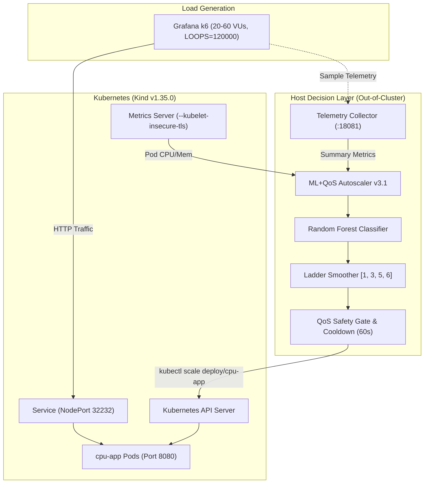
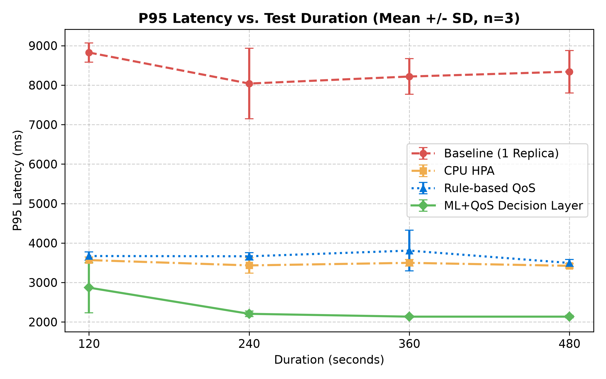
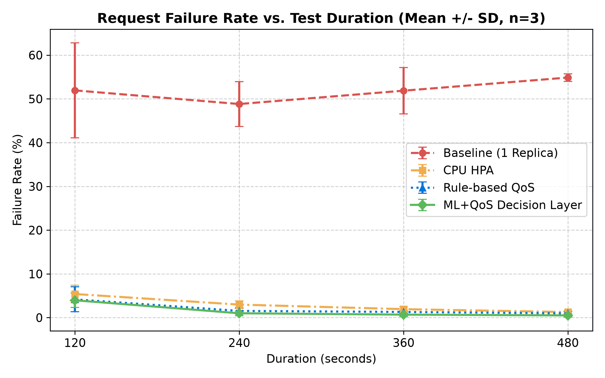
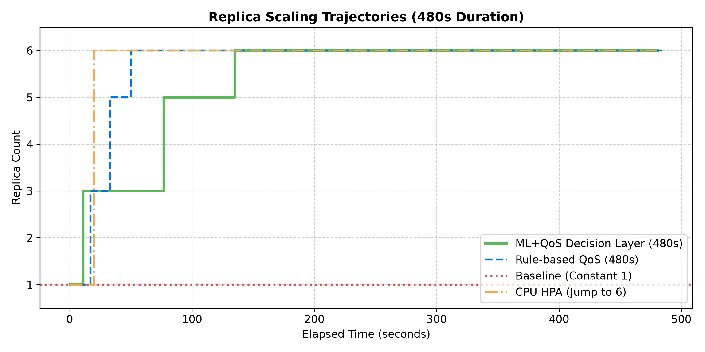
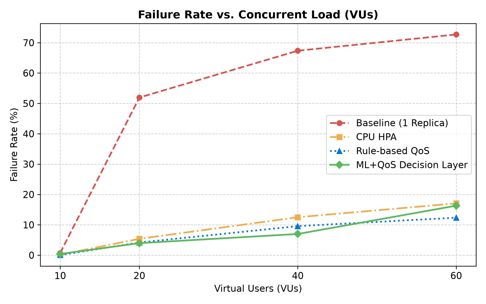

<div align="center">

# Kubernetes ML/QoS-Aware Autoscaling Decision Layer

[](https://python.org)
[](https://kubernetes.io)
[](https://kind.sigs.k8s.io)
[](https://scikit-learn.org)
[](https://opensource.org/licenses/MIT)
[]()

**An extensible machine learning and Quality-of-Service (QoS) decision layer for Kubernetes autoscaling that synthesizes physical resource utilization with service-level latency and failure indicators.**

*Author:* **Mohammadali Nastaran**  
*Master's Thesis Research Project — Cloud Computing & Distributed Systems*

</div>

---

## 📌 Core Defense Statement (Scientific Positioning)

> **"The contribution of this work is not replacing Kubernetes HPA, but introducing an extensible ML/QoS-aware decision layer that combines resource utilization and service quality indicators for Kubernetes autoscaling decisions."**

### Academic Guardrails
- **Extensible Augmentation, Not Replacement**: The proposed controller is an out-of-cluster decision layer acting through standard Kubernetes scaling APIs. It does not replace internal Kubernetes scheduling or HPA components.
- **Empirical Multi-Arm Parity**: Benchmarked strictly against three alternative arms under identical synthetic CPU saturation (`LOOPS=120000`):
  1. **Fixed-replica Baseline** ($1$ replica)
  2. **Standard Kubernetes CPU-based HPA** ($50\%$ utilization target)
  3. **Rule-based QoS Controller** (threshold heuristic)
  4. **Proposed ML+QoS Decision Layer v3.1** (Random Forest + Ladder Clamping + Cooldown + Dual Safety Gates)
- **Statistical Rigor**: All experimental cells report mean $\pm$ standard deviation over $n=3$ independent runs, verified by Welch's $t$-test.

---

## 🏗️ System Architecture



### Control Loop & Features
Every $5$ seconds, the controller gathers a 6-dimensional telemetry vector:
$$\mathbf{X} = \begin{bmatrix} \text{CPU}_{\%}, & \text{Mem}_{\text{Mi}}, & \text{Requests}, & \text{Fail}_{\%}, & \text{Latency}_{\text{avg}}, & \text{Latency}_{P95} \end{bmatrix}$$

1. **Inference**: Tabular Random Forest Classifier outputs target replica class.
2. **Ladder Smoothing**: Target is clamped to discrete values $[1, 3, 5, 6]$ to prevent step-shock.
3. **Safety Gate**:
   - **Scale-Up Gate**: Permitted only if system is genuinely stressed ($P95 \ge 700\text{ ms} \lor \text{Fail} \ge 1\% \lor \text{CPU} \ge 50\%$).
   - **Scale-Down Gate**: Permitted only if quality is strictly stable ($P95 \le 800\text{ ms} \land \text{Fail} \le 1\% \land \text{CPU} \le 60\%$).
4. **Cooldown Mechanism**: Enforces a $60\text{s}$ stabilization window between physical scaling actions to prevent replica oscillation (thrashing).

---

## 📊 Key Empirical Results

### 1. Duration Study ($n=3$ Replicates per Cell, VU=20)
*App-only custom metrics (`app_requests`, `app_req_failed`, `app_req_duration`), excluding background telemetry.*

| Arm | Duration | Requests ($\mu$) | Failure Rate ($\mu \pm \sigma$) | P95 Latency ($\mu \pm \sigma$) | Avg Latency ($\mu$) | Throughput | Replicas |
|:---|:---:|:---:|:---:|:---:|:---:|:---:|:---:|
| **Baseline** | 120s | 322.3 | $51.94\% \pm 10.86$ | $8826 \text{ ms} \pm 242$ | 2784 ms | 2.48 req/s | 1 |
| | 240s | 630.7 | $48.82\% \pm 5.14$ | $8040 \text{ ms} \pm 892$ | 2745 ms | 2.52 req/s | 1 |
| | 360s | 926.0 | $51.87\% \pm 5.30$ | $8218 \text{ ms} \pm 452$ | 2599 ms | 2.50 req/s | 1 |
| | 480s | 1207.0 | $54.87\% \pm 0.86$ | $8341 \text{ ms} \pm 538$ | 2566 ms | 2.46 req/s | 1 |
| **CPU HPA** | 120s | 1004.3 | $5.40\% \pm 2.00$ | $3568 \text{ ms} \pm 77$ | 1621 ms | 8.00 req/s | 6 |
| | 240s | 2243.0 | $2.98\% \pm 0.85$ | $3433 \text{ ms} \pm 197$ | 1630 ms | 9.20 req/s | 6 |
| | 360s | 3411.0 | $1.94\% \pm 0.55$ | $3498 \text{ ms} \pm 83$ | 1637 ms | 9.36 req/s | 6 |
| | 480s | 4778.7 | $1.28\% \pm 0.31$ | $3423 \text{ ms} \pm 57$ | 1602 ms | 9.89 req/s | 6 |
| **Rule QoS** | 120s | 1048.3 | $4.18\% \pm 2.85$ | $3671 \text{ ms} \pm 104$ | 1689 ms | 8.53 req/s | 6 |
| | 240s | 2260.0 | $1.54\% \pm 0.65$ | $3664 \text{ ms} \pm 93$ | 1719 ms | 9.28 req/s | 6 |
| | 360s | 3405.0 | $1.30\% \pm 0.25$ | $3808 \text{ ms} \pm 516$ | 1655 ms | 9.37 req/s | 6 |
| | 480s | 4708.0 | $0.98\% \pm 0.35$ | $3495 \text{ ms} \pm 91$ | 1666 ms | 9.73 req/s | 6 |
| **ML+QoS** | 120s | 1099.0 | $3.97\% \pm 1.65$ | $2870 \text{ ms} \pm 635$ | 1387 ms | 8.94 req/s | 5 |
| | 240s | 3498.3 | $1.00\% \pm 0.55$ | $2207 \text{ ms} \pm 68$ | 902 ms | 14.37 req/s | 6 |
| | 360s | 5554.3 | $0.69\% \pm 0.44$ | $2135 \text{ ms} \pm 26$ | 899 ms | 15.35 req/s | 6 |
| | 480s | 7723.7 | **0.51% ± 0.38** | **2135 ms ± 32** | **876 ms** | **16.03 req/s** | 6 |

### 2. Statistical Significance (Welch's $t$-test at 480s)
- **P95 Latency Reduction (ML+QoS vs. HPA)**: $t = -34.20, \mathbf{p < 0.0001}$ (P95 latency reduced by $37.6\%$ from $3423\text{ ms}$ to $2135\text{ ms}$).
- **Throughput Elevation (ML+QoS vs. HPA)**: $t = 27.76, \mathbf{p < 0.0001}$ (Throughput increased by $62.1\%$ from $9.89$ to $16.03\text{ req/s}$).
- **Replica Oscillation (Jitter)**: $0$ scale-down thrashing events recorded across all $n=3$ replicates.

### 3. Variable Concurrency Study ($10, 20, 40, 60$ VUs)
*Evaluating scalability under varying load profiles (Duration = 120s):*

| Concurrency | Baseline Fail (%) | HPA Fail (%) | Rule QoS Fail (%) | ML+QoS Fail (%) | ML+QoS P95 Latency |
|:---:|:---:|:---:|:---:|:---:|:---:|
| **10 VU (Light)** | $0.74\%$ | $0.14\%$ | $0.06\%$ | **0.40%** | **1884.7 ms** |
| **20 VU (Nominal)** | $51.94\%$ | $5.40\%$ | $4.18\%$ | **3.97%** | **2870.0 ms** |
| **40 VU (Heavy)** | $67.35\%$ | $12.51\%$ | $9.57\%$ | **6.99%** | **2815.0 ms** |
| **60 VU (Extreme)** | $72.70\%$ | $17.07\%$ | $12.36\%$ | **16.31%** | **5879.8 ms** |

---

## 📈 Visual Evaluation

<div align="center">

| P95 Latency vs. Duration | Failure Rate vs. Duration |
|:---:|:---:|
|  |  |

| Replica Timeline (480s Study) | Concurrency vs. Failure Rate |
|:---:|:---:|
|  |  |

</div>

---

## 🚀 Quickstart & Reproduction Guide

### 1. Requirements
- Linux (Ubuntu 22.04+ recommended)
- Docker & Kind v1.35.0
- kubectl & k6 load testing tool
- Python 3.12+ with `scikit-learn`, `pandas`, `numpy`, `joblib`, `requests`

### 2. Cluster & Application Setup
```bash
# 1. Create Kind cluster
kind create cluster --config manifests/kind-cluster.yaml

# 2. Deploy Metrics Server with insecure TLS patch
kubectl apply -f https://github.com/kubernetes-sigs/metrics-server/releases/latest/download/components.yaml
kubectl -n kube-system patch deployment metrics-server --type=json -p '[{"op":"add","path":"/spec/template/spec/containers/0/args/-","value":"--kubelet-insecure-tls"}]'

# 3. Deploy application workload
kubectl apply -f manifests/cpu-app.yaml
kubectl -n thesis-exp rollout status deployment cpu-app
```

### 3. Running Telemetry & Autoscalers
```bash
# Start background telemetry collector (port 18081 for ML arm)
python3 scripts/metrics_collector_ml.py > collector.log 2>&1 &

# Start ML+QoS Controller v3.1
python3 scripts/ml_qos_autoscaler_v3_1.py \
  --collector http://127.0.0.1:18081/summary \
  --log controller.csv
```

### 4. Executing Benchmark Workload
```bash
k6 run \
  -e TARGET=http://172.18.0.2:32232 \
  -e COLLECTOR=http://127.0.0.1:18081 \
  -e VUS=20 \
  -e DURATION=240s \
  -e LOOPS=120000 \
  scripts/qos_test_eval.js
```

---

## 📁 Repository Structure

```
.
├── CITATION.cff               # Academic citation metadata
├── LICENSE                    # MIT License
├── README.md                  # Comprehensive documentation
├── requirements.txt           # Python environment dependencies
├── app/                       # Target application source (Flask + CPU loop)
│   ├── app.py
│   └── Dockerfile
├── manifests/                 # Kubernetes and Kind manifests
│   ├── kind-cluster.yaml
│   ├── cpu-app.yaml
│   └── hpa.yaml
├── scripts/                   # Controllers, collectors, and evaluators
│   ├── ml_qos_autoscaler_v3_1.py
│   ├── qos_aware_autoscaler.py
│   ├── metrics_collector.py
│   ├── metrics_collector_ml.py
│   ├── qos_test_eval.js
│   └── build_thesis_charts.py
├── dataset/                   # Model artifact and runtime datasets
│   ├── random_forest_model.pkl
│   ├── model_metadata.json
│   └── final_ml_training.csv
├── evaluation/                # Benchmark summaries and raw metrics
│   ├── means.csv              # Aggregated n=3 duration statistics
│   ├── summary.csv            # 48 raw duration runs
│   └── concurrency_summary.csv # Variable VU benchmark data
└── plots/                     # High-resolution (300 DPI) publication charts
    ├── chart_duration_vs_p95.png
    ├── chart_duration_vs_failure.png
    ├── chart_duration_vs_throughput.png
    ├── chart_replica_timeline_480s.png
    └── chart_concurrency_vs_p95.png
```

---

## 📖 Citation

If you utilize this architecture, controller implementation, or benchmark dataset in academic research, please cite:

```bibtex
@mastersthesis{nastaran2026k8sautoscaling,
  author       = {Mohammadali Nastaran},
  title        = {Design and Implementation of an ML/QoS-aware Autoscaling Decision Layer for Kubernetes Applications},
  school       = {Master's Thesis Research},
  year         = {2026},
  url          = {https://github.com/mohammadali-nastaran/k8s-ml-qos-autoscaler}
}
```

---

## 📄 License
This project is licensed under the [MIT License](LICENSE) — see the LICENSE file for details.
Copyright (c) 2026 **Mohammadali Nastaran**.
